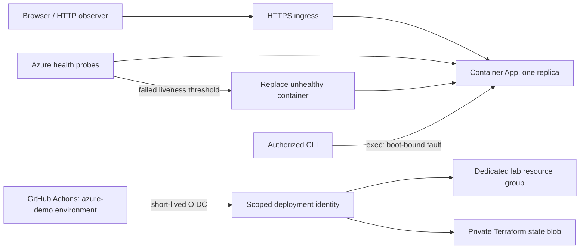

# Azure Recovery Lab

A small web service built to make failure and recovery observable: fail a health check, watch an external supervisor replace the process, and verify the new instance over HTTP.

**Current evidence:** local recovery is measured. Terraform validates. Azure deployment and platform-triggered recovery are **not yet verified**. Nothing runs permanently in Azure.

## What this demonstrates

- A Python service with explicit startup, liveness and readiness probes.
- A read-only dashboard, structured JSON logs and Prometheus-format metrics.
- CLI-only, disabled-by-default fault injection bound to one process identity.
- Container Apps Consumption infrastructure in Terraform, plus separate bootstrap/state resources.
- GitHub Actions OIDC federation instead of a stored Azure deployment password or client secret.
- A temporary experiment with documented cost assumptions and teardown.

This is a **single-replica recovery lab**, not a highly available application. A failed replica causes visible downtime. Restarting a process does not repair an application bug, recover a database or prove disaster recovery.

## Architecture



Locally, a finite Python supervisor stands in for the cloud orchestrator. Its proof is labeled `LOCAL_PROCESS_SUPERVISOR_NOT_AZURE`; it is not passed off as a cloud test.

## Run locally

Python 3.9+ on Linux or macOS is enough for the local service and tests. No Azure account or runtime package installation is required for this path.

```sh
python3 -m recovery_lab --port 8080
```

Open <http://127.0.0.1:8080>. Stop it with Ctrl+C. A second process must use a separate `LAB_STATE_DIR`; the service refuses to overwrite an active instance's control state.

### Run the recovery experiment

```sh
python3 -m unittest discover -s tests -v
python3 scripts/recovery_drill.py --trials 3
```

The drill starts its own isolated process group, records healthy HTTP, injects an unhealthy marker, observes HTTP 503, and requires a healthy **different boot UUID** after the supervisor restarts it. It then cleans up its own processes. A failed rerun replaces the current result with `FAIL`, not a stale `PASS`.

Recorded local trials: **1.151 s, 1.142 s, 1.153 s**, sampled every 100 ms. These are a small local experiment, not an SLA or a prediction of Azure recovery time. See [the structured result](evidence/local-recovery.json) and its run-bound event log.

## Inspect the service

| Endpoint | Purpose |
| --- | --- |
| `/` | Read-only live dashboard |
| `/api/status` | Boot UUID, uptime, health, real request count |
| `/health/live` | 200 when healthy, 503 for the injected failure |
| `/health/ready` | Readiness for the same failure model |
| `/metrics` | Process health, request counter and uptime |

Only GET and HEAD are accepted. There is **no public fault endpoint**. In a controlled experiment, `LAB_ENABLE_FAULTS=1` enables `python -m recovery_lab.fault` inside the selected container. It marks that exact boot unhealthy until replacement; it does not issue a restart itself.

## Container and cloud

The production image runs Gunicorn as non-root UID 10001. Python dependencies have SHA256 hashes. CI builds and smoke-tests the actual image on Linux; the local process drill uses the standard-library server.

- [Deployment and OIDC setup](docs/AZURE.md)
- [Budget assumptions and cleanup](docs/COST_AND_CLEANUP.md)
- [Evidence definitions and review checklist](docs/EVIDENCE.md)
- [Visual system](DESIGN.md)

### Workflows

- **Verify recovery lab:** unit/guard tests, measured local drill, Terraform format/schema validation and production-container smoke checks. No Azure access.
- **Publish portfolio container:** manual GHCR image build. The package must be publicly pullable before cloud deployment; the repository being public is not sufficient.
- **Temporary Azure recovery demo:** manual, main-branch-only, scoped `azure-demo` identity. Deploys an immutable image, runs one experiment and attempts teardown even after failure. There are no scheduled cloud jobs.

## Tradeoffs

Liveness and readiness intentionally use the same simple failure model; a production service would distinguish transient dependency failure from a process that needs replacement. Process metrics reset after restart. Browser observations are transient, not incident history. Stream-only Azure logs avoid a separate ingestion workspace for this short demo but must be captured during the run. Fault injection is a local/exec capability, not a public control plane.

## Verification status

- Local health, fault-isolation and cloud-target guard tests: passed.
- Three local restart experiments and owned-process cleanup: passed.
- Both Terraform roots: schema-valid with the pinned provider; **no live plan/apply yet**.
- Linux production container: see the actual GitHub Actions run; no local Docker daemon was available during initial development.
- Azure account, OIDC exchange, live recovery, platform cause, final billing and cloud cleanup: pending live verification.

See [sources and pinned versions](docs/SOURCES.md) for the vendor references used to build this lab.
